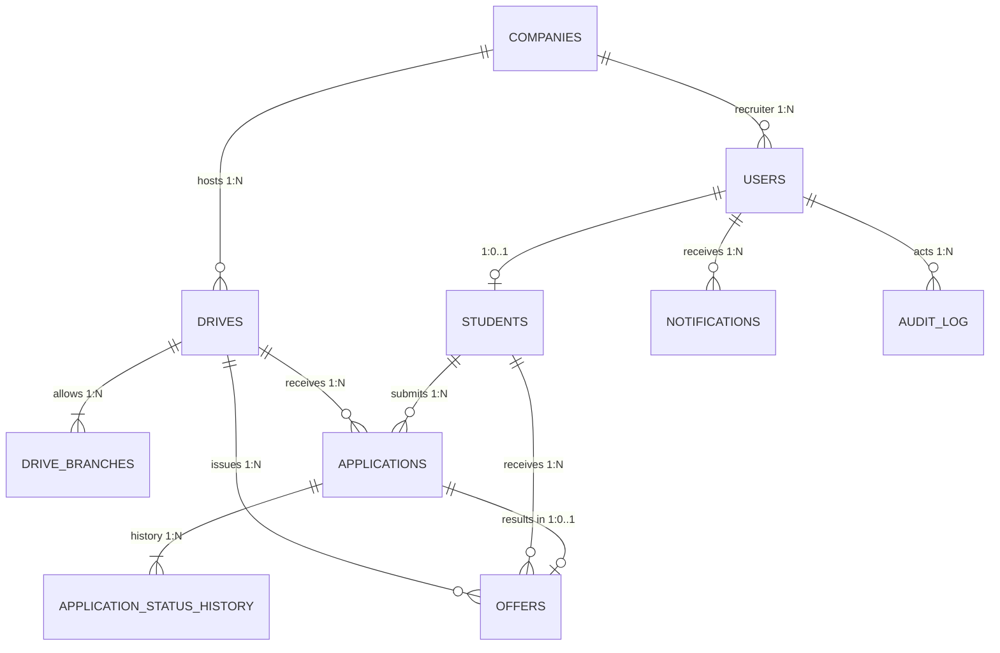

# Campus Placement Management System (UCS553 Mini-Project)

A complete **JavaFX 21** desktop application backed by a relational database (**SQLite** by default, **MySQL**-ready via `config.properties`) using plain **JDBC (`PreparedStatement`)** and the **DAO design pattern**—built with zero external frameworks (no Spring, no Hibernate/JPA, no Lombok).

---

## 1. Setup & Quick Start

### Prerequisites
- **Java 21** (OpenJDK 21)
- **Maven 3.9+**

### Run Unit & Integration Tests
```bash
mvn clean test
```

### Launch Desktop Application
```bash
mvn clean javafx:run
```
On first launch, `DatabaseInitializer` automatically creates `data/placement.db`, applies `schema.sql`, and seeds `seed.sql` (also creates `logs/`, `resumes/`, and `backups/`).

### Switching to MySQL
Edit `src/main/resources/config.properties`:
1. Set `db.dialect=mysql`
2. Set `db.url`, `db.username`, and `db.password`
3. Add `mysql-connector-j` to `pom.xml` (DDL and seed scripts for MySQL are included in `src/main/resources/schema-mysql.sql` and `src/main/resources/seed-mysql.sql`).

### Keyboard Shortcuts
- `Enter` on Login triggers **Sign In** (`defaultButton`)
- `Ctrl + L` (Windows/Linux) / `Cmd + L` (macOS) logs out the active user
- `F1` opens the **Placement Policy & System Architecture** screen

---

## 2. Demo Credentials

| Role | Email | Password |
| :--- | :--- | :--- |
| **Admin / TPO** | `admin@campus.edu` | `Admin@123` |
| **Recruiter (TCS)** | `recruiter.tcs@campus.edu` | `Recruiter@123` |
| **Recruiter (Infosys)** | `recruiter.infosys@campus.edu` | `Recruiter@123` |
| **Student (CSE)** | `aarav.sharma@campus.edu` | `Student@123` |
| **Student (ECE)** | `rohit.kumar@campus.edu` | `Student@123` |
| **All 26 Seeded Students** | `<firstname>.<lastname>@campus.edu` | `Student@123` |

---

## 3. Architecture

Strict 5-layer architecture under `com.campus.placement`:
- `app/` — `MainApp` (`Application` lifecycle) and `SceneManager` (navigation, session, `Task` async runner, shortcuts)
- `controller/` — FXML controllers + programmatic `AboutPolicyView` (controllers never call DAOs directly)
- `service/` — Business rules, eligibility, pipeline transitions, JDBC transactions, audit logging, reports
- `dao/` — Generic `Dao<T, ID>` + entity interfaces and `Jdbc*Dao` implementations (`PreparedStatement` only)
- `db/` — `ConnectionManager` (FK pragma, `executeInTransaction`) and `DatabaseInitializer`
- `model/`, `exception/`, `util/`, `config/`

---

## 4. Database ER Diagram (3NF)



Key constraints: `UNIQUE` on `users.email`, `students.roll_no`, `students.email`, `companies.name`; composite `UNIQUE(student_id, drive_id)` on `applications`; `CHECK` on `cgpa (0..10)` and `active_backlogs (>= 0)`; `PRAGMA foreign_keys = ON`.

---

## 5. Screens Overview (UI Walkthrough)

- **Auth & Info:** Login (`login.fxml`), Student Self-Registration (`register.fxml`), Programmatic Policy & Architecture (`AboutPolicyView.java`).
- **Admin / TPO Portal:** Dashboard with KPI tiles + `PieChart` & `BarChart` (`admin_dashboard.fxml`), Companies CRUD (`admin_companies.fxml`), Drives & Eligibility CRUD (`admin_drives.fxml`), Applicant Pipeline & Offer Issuance (`admin_applicants.fxml`), Student Management (`admin_students.fxml`), Reports / CSV Export & Import / Printable `.txt` / `.ser` Snapshot / Audit Log (`admin_reports.fxml`).
- **Student Portal:** Dashboard & Notifications (`student_dashboard.fxml`), Drive Browser with auto-computed `Eligible / Not eligible + reason` (`student_drives.fxml`), Application Timeline & Transactional Offer Accept/Decline (`student_applications.fxml`), Profile & Resume Upload (`student_profile.fxml`).
- **Recruiter Portal:** Company-scoped Drive & Applicant Shortlisting (`recruiter_dashboard.fxml`).

---

## 6. UCS553 Syllabus-to-Code Mapping

| Unit | Topic | Where Demonstrated in Code |
| :--- | :--- | :--- |
| **Unit 1** | Packages, Interfaces, Abstract Classes, Access Modifiers, Static vs Instance, Maven | `pom.xml`, `BaseEntity.java`, `Dao.java`, `AppConfig.java` |
| **Unit 2** | Custom Exceptions, Collections (`ArrayList`, `LinkedList`, `HashSet`, `HashMap`), `Iterator`, `Comparator`, Generics, `Optional`, `Objects`, `Math`, `LocalDate`/`LocalDateTime` | `PlacementException.java` hierarchy, `Dao<T,ID>`, `Drive.java` (`HashSet`), `JdbcApplicationDao.java` (`LinkedList`), `StudentService.java` (`Comparator`), `ReportService.java` (`Iterator`, `Math`, `HashMap`), `DateUtil.java`, `PasswordUtil.java` (`Objects`) |
| **Unit 3** | Byte & Character Streams, CSV Export/Import, Resume File Copy, Object Serialization, `java.util.logging`, `config.properties` | `FileUtil.java` (`BufferedInputStream`/`OutputStream`), `CsvUtil.java` (`BufferedReader`/`Writer`), `ReportService.java` (`PrintWriter`), `SerializationUtil.java` (`ObjectInputStream`/`OutputStream`), `LoggerUtil.java`, `AppConfig.java` |
| **Unit 4** | JDBC Architecture, CRUD, `PreparedStatement`, `ResultSet`, Transactions (`commit`/`rollback`), DAO Pattern | `ConnectionManager.java`, `DatabaseInitializer.java`, `Jdbc*Dao.java`, `OfferService.java`, `ApplicationService.java` |
| **Unit 5** | JavaFX Lifecycle (`init`/`start`/`stop`), Stage/Scene/Scene Graph, Layouts, Controls, Events, Validation, Alerts, `Task` | `MainApp.java`, `SceneManager.java`, `AboutPolicyView.java` (programmatic layouts), `styles.css`, all `controller/*.java` & `fxml/*.fxml` |

---

## 7. Optional Embedded REST Server (Phase 8)

Isolated from the JavaFX app, `PlacementRestServer` uses JDK's built-in `com.sun.net.httpserver.HttpServer`:
```bash
mvn compile exec:java -Dexec.mainClass="com.campus.placement.rest.PlacementRestServer"
```
Then open `http://localhost:8080/` (or query `GET /api/drives` and `GET /api/stats`).
